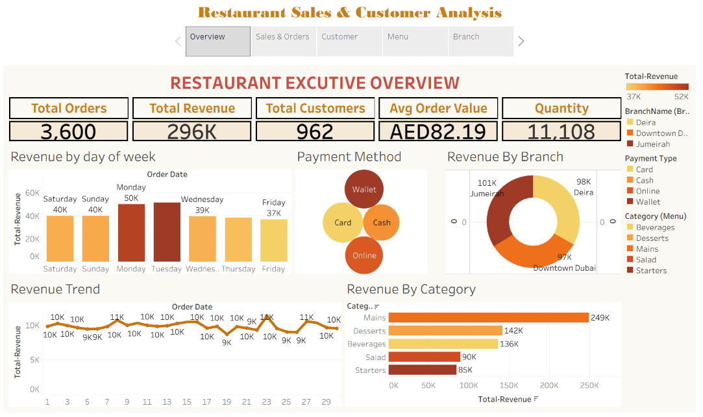
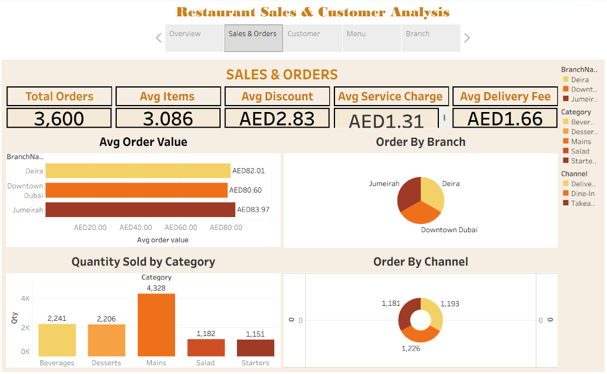
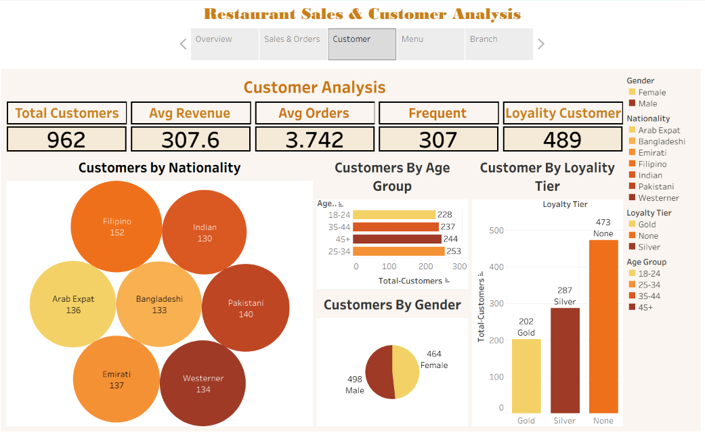
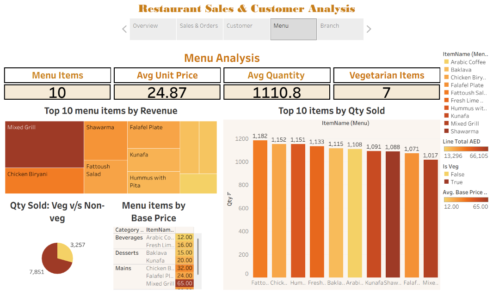
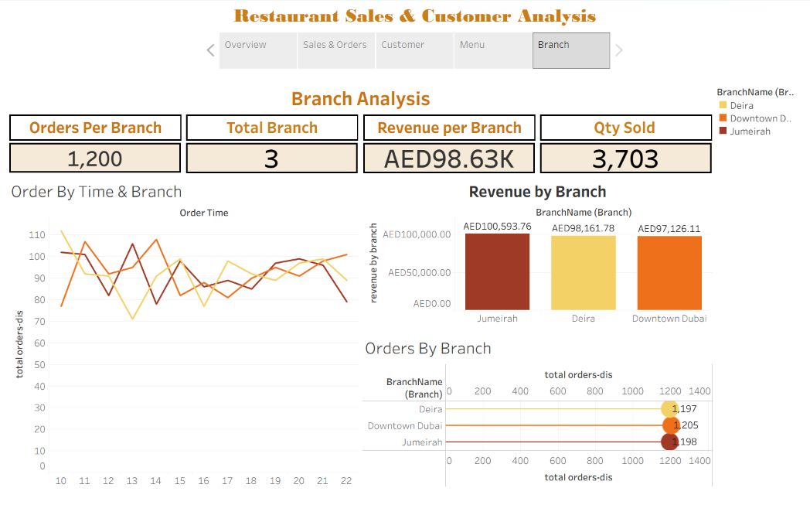

# 🍽️ Restaurant Sales & Customer Analytics Dashboard

An interactive restaurant analytics project developed using **Microsoft Excel, Power Query, and Tableau** to analyze sales performance, customer behavior, menu performance, and branch-level operations.

## 🎯 Business Problem

Restaurant management needs a clear view of sales, customers, menu performance, and branch operations to make informed business decisions.

Raw restaurant transaction data makes it difficult to identify:

- Revenue and order trends
- High-performing menu categories and items
- Customer demographics and loyalty patterns
- Branch-level sales performance
- Differences in ordering behavior across channels

The objective of this project is to transform and analyze restaurant sales data and develop an interactive Tableau dashboard that provides actionable business insights.

## 🛠️ Tools & Technologies

- **Microsoft Excel** – Data analysis and validation
- **Power Query** – Data cleaning and transformation
- **Tableau** – Interactive dashboard development
- **Data Visualization** – KPI and trend analysis
- **Business Analysis** – Sales, customer, menu, and branch performance

## 🔄 Data Preparation

The dataset was prepared using Excel and Power Query.

Key data preparation activities included:

- Data cleaning
- Removing inconsistencies
- Validating data fields
- Transforming columns
- Standardizing data formats
- Preparing data for Tableau analysis

## 📊 Dashboard Structure

The Tableau dashboard contains five analytical pages:

### 1. Executive Sales Overview

Provides a high-level view of:

- Total Orders
- Total Revenue
- Total Customers
- Average Order Value
- Quantity Sold
- Revenue trends
- Payment methods
- Revenue by branch
- Revenue by menu category

### 2. Sales & Order Analysis

Analyzes:

- Average Order Value by branch
- Orders by branch
- Quantity sold by category
- Orders by sales channel
- Average discount
- Average service charge
- Average delivery fee

### 3. Customer Analytics

Analyzes:

- Customer nationality
- Customer age groups
- Gender distribution
- Loyalty tiers
- Average customer revenue
- Average number of orders
- Frequent customers

### 4. Menu & Product Performance

Analyzes:

- Top menu items by revenue
- Top menu items by quantity sold
- Vegetarian vs non-vegetarian sales
- Menu item pricing
- Average quantity
- Menu product performance

### 5. Branch Performance Analysis

Analyzes:

- Orders per branch
- Revenue per branch
- Quantity sold by branch
- Order patterns by time
- Branch-level sales performance

## 🔑 Key KPIs

The dashboard tracks important business KPIs including:

- Total Orders
- Total Revenue
- Total Customers
- Average Order Value
- Quantity Sold
- Average Discount
- Average Service Charge
- Average Delivery Fee
- Customer Revenue
- Customer Orders
- Branch Revenue

## 🔎 Key Insights

Based on the dashboard analysis:

1. **Revenue performance** – The restaurant generated approximately **AED 296K in total revenue** from **3,600 orders**.

2. **Menu category performance** – **Mains** are the strongest revenue-generating category, contributing approximately **AED 249K**.

3. **Branch performance** – **Jumeirah** generated the highest branch revenue at approximately **AED 100.6K**.

4. **Customer loyalty** – A significant number of customers are currently classified under the **None loyalty tier**, indicating an opportunity to strengthen customer retention and loyalty programs.

5. **Customer diversity** – The customer base represents multiple nationalities, providing opportunities for targeted customer engagement strategies.

6. **Sales timing** – Monday and Tuesday show strong revenue performance in the weekly analysis, which can support staffing and promotional planning.

7. **Menu performance** – The analysis identifies high-volume and high-revenue menu items that can help management optimize menu planning and product promotion.

## 💡 Business Recommendations

1. **Promote high-performing menu categories** to maximize revenue from products that already demonstrate strong demand.

2. **Strengthen customer loyalty programs** by targeting customers who are not currently assigned to a loyalty tier.

3. **Analyze Jumeirah branch performance** to identify successful practices that could potentially be replicated across other branches.

4. **Optimize staffing and promotions** around high-performing sales periods.

5. **Review low-performing menu items** and evaluate whether pricing, promotion, or menu placement improvements are required.

6. **Use customer demographics** to develop more targeted marketing campaigns.

7. **Monitor branch-level KPIs regularly** to identify performance gaps and operational opportunities.

## 📸 Dashboard Preview

## 📁 Project Files

- Tableau dashboard screenshots
- Excel source/analysis workbook
- Power Query data preparation
- Tableau dashboard

## 🎓 Skills Demonstrated

- Data Cleaning
- Data Transformation
- Excel Data Analysis
- Power Query
- Tableau
- Data Visualization
- KPI Development
- Sales Analytics
- Customer Analytics
- Menu/Product Analytics
- Branch Performance Analysis
- Business Insights
- Business Recommendations
